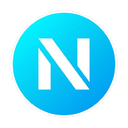

# NexCoin Core (NXC)

<p align="center">
  
</p>

<p align="center">
  <strong>Fast, Pure CPU-Mineable, ASIC-Resistant Layer-1 Blockchain</strong><br>
  Official Website: <a href="https://nexcoin.net">https://nexcoin.net</a>
</p>

---

## 🌟 What is NexCoin?

NexCoin (NXC) is a decentralized, peer-to-peer digital currency engineered with a strict **"One-CPU-One-Vote"** philosophy. Based on the time-tested cryptographic architecture of Bitcoin Core and Sugarchain, NexCoin implements the memory-hard **Yespower** proof-of-work algorithm to deliver true decentralization:

- **Strictly ASIC-Resistant & GPU-Inefficient:** Designed to ensure standard consumer desktop and laptop processors participate equally in securing the blockchain.
- **Lightning-Fast 5-Second Blocks:** Near-instant transaction confirmations with real-time mempool propagation.
- **Fair Launch (0% Pre-mine):** No ICO, no developer tax, no pre-allocated founder coins. 100% of all coins are mined by the community.

---

## ⚡ Specifications

| Parameter | Value |
| :--- | :--- |
| **Coin Name** | NexCoin |
| **Ticker Symbol** | **NXC** |
| **PoW Algorithm** | **Yespower** (Yespower 1.0.1 - CPU Only) |
| **Block Time** | **5 Seconds** (DigiShieldZEC real-time difficulty retargeting) |
| **Block Reward** | **2.0 NXC** per block |
| **Total Max Supply** | **~24,000,000 NXC** |
| **Halving Interval** | 6,000,000 blocks (~347 days / ~1 year) |
| **Coinbase Maturity** | 100 blocks |
| **P2P Network Port** | `9333` |
| **RPC Management Port** | `9332` |
| **Default Address Format** | Native SegWit Bech32 (starts with `nex1q...`) |
| **Legacy Address Format** | P2PKH (starts with `N...`) |
| **DNS Seeds** | `seed.nexcoin.net`, `seed2.nexcoin.net` |
| **Pre-mine** | **0.00% (Pure Fair Launch)** |

---

## 📥 Downloads (Pre-built Binaries)

Official binary releases for Windows and Linux are available under the [Releases](https://github.com/nexcoin-project/nexcoin/releases) tab.

- **Windows 64-bit:** `NexCoin-v1.0.0-win64.zip` (Includes `nexcoin-qt.exe`, `nexcoind.exe`, `nexcoin-cli.exe`)
- **Linux 64-bit:** `NexCoin-v1.0.0-linux64.tar.gz`

---

## ⛏ Mining NexCoin (CPU Mining)

NexCoin can be mined using any standard Yespower-compatible CPU miner (such as `sugarmaker` or `cpuminer-opt`).

### Example with Sugarmaker:
```bash
./sugarmaker -a yespowersugar -o stratum+tcp://seed.nexcoin.net:9333 -u YOUR_NEXCOIN_ADDRESS -t 4
```

### Solo Mining with NexCoin Core:
Inside the NexCoin Core GUI console (`Help -> Debug Window -> Console`), or via `nexcoin-cli`:
```bash
nexcoin-cli generatetoaddress 1 YOUR_NEXCOIN_ADDRESS
```

---

## 🛠 Building NexCoin Core from Source

### Prerequisites (Ubuntu / Debian):
```bash
sudo apt update
sudo apt install -y build-essential libtool autotools-dev automake pkg-config \
                    bsdmainutils python3 libssl-dev libevent-dev libboost-all-dev \
                    libdb5.3++-dev git
```

### Build Instructions:
```bash
# Clone repository
git clone https://github.com/nexcoin-project/nexcoin.git
cd nexcoin

# Generate build configuration
./autogen.sh

# Configure and compile (Headless Daemon + CLI)
./configure --with-incompatible-bdb --without-gui --disable-tests --disable-bench
make -j$(nproc)
sudo make install
```

### Cross-Compiling for Windows (from Linux using MinGW-w64):
```bash
make -C depends HOST=x86_64-w64-mingw32 -j$(nproc)
./autogen.sh
./configure --prefix=`pwd`/depends/x86_64-w64-mingw32 --disable-tests --disable-bench
make -j$(nproc)
```

---

## ⚙ Configuration (`nexcoin.conf`)

By default, NexCoin Core connects automatically to official DNS seeds (`seed.nexcoin.net`). For custom daemon setups, create a configuration file in:
- **Windows:** `%APPDATA%\NexCoin\nexcoin.conf`
- **Linux:** `~/.nexcoin/nexcoin.conf`

```ini
server=1
listen=1
daemon=1
rpcuser=nexcoinuser
rpcpassword=ChangeThisToYourSecurePassword123!
rpcport=9332
port=9333
```

---

## 📄 License & Acknowledgments

NexCoin Core is released under the terms of the **MIT License**. See [COPYING](COPYING) for more information.

NexCoin is proudly built upon the foundational cryptographic work of:
- **Satoshi Nakamoto** (Bitcoin)
- **The Bitcoin Core Developers**
- **Alexander Peslyak** (Yespower proof-of-work 1.0.1)
- **The Zcash Developers** (DigiShieldZEC dynamic retargeting)
- **The Sugarchain Developers**
